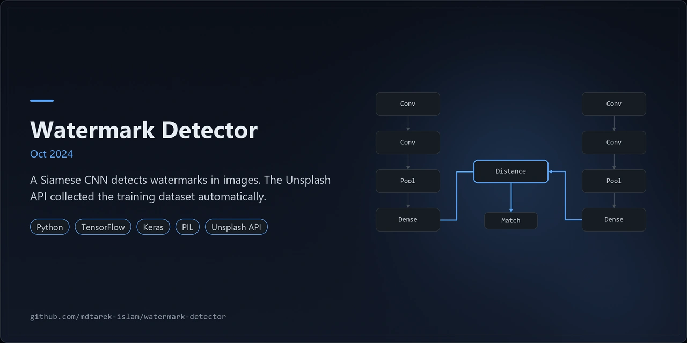
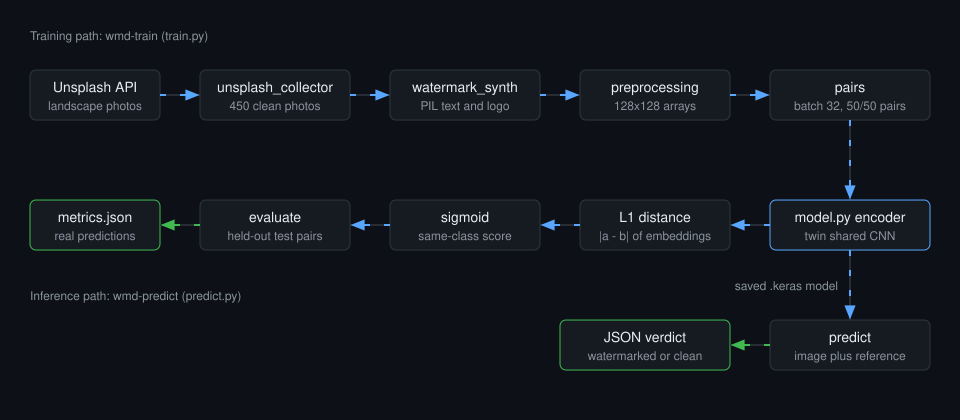
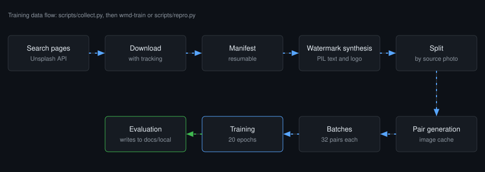

<p align="center"></p>

# Watermark Detector

A Siamese CNN that tells watermarked images from clean ones.

## Overview

A Siamese CNN that detects watermarks in images. The Unsplash API collects the training photos, and PIL adds synthetic watermarks to label them. Oct 2024.

## Results (Oct 2024)

- Achieved 87% watermark detection accuracy with a Siamese CNN built and fine-tuned in TensorFlow, Keras and PIL.
- Automated the build of a 450-image dataset through the Unsplash API.
- Optimised memory use during 32-image batch training across 20 epochs.

Metrics: detection accuracy 87%, dataset size 450 images, batch size 32, 20 epochs.

Measured in the Oct 2024 project.

| Layer | Technology |
|---|---|
| Language | Python 3.10 or later |
| Model | TensorFlow 2.16 or later, Keras |
| Imaging | PIL (pillow) |
| Data source | Unsplash API |
| Testing | pytest |

## Architecture



1. `unsplash_collector` downloads clean photos from the Unsplash API and records them in a manifest.
2. `watermark_synth` gives each photo a synthetic text or logo watermark with PIL, producing labelled images.
3. `preprocessing` resizes images to 128x128 arrays.
4. `pairs` builds half same-class and half cross-class pairs, served in batches of 32.
5. `model` encodes both images with one shared CNN, takes the L1 distance and applies a sigmoid.
6. `evaluate` scores held-out test pairs and `train` writes `metrics.json` to the model folder.
7. `predict` loads the saved model and compares one image with a reference of known class.

### Training data flow



*Training data flow: search pages, tracked downloads, a resumable manifest, PIL watermarks, a split by source photo, cached pairs, batches of 32 and 20 epochs. Evaluation output stays in `docs/local`.*

## Features

- Collects photos from the Unsplash API with a resumable manifest.
- Generates text and logo watermarks to label a clean photo set.
- Splits 70/15/15 by source photo, so a clean photo and its watermarked copy never cross splits.
- Trains a Siamese CNN with a shared encoder, L1 distance and sigmoid output.
- Writes accuracy, precision and recall to `metrics.json` in the model folder from held-out predictions only.
- Provides two console commands: `wmd-train` and `wmd-predict`.

### Engineering notes

- Defaults: 450 photos, batch 32, 20 epochs.
- The full pipeline ran end to end on CPU: 450 Unsplash photos collected through the API with download tracking, synthetic watermarks, Siamese pairs, and 20 epochs at batch 32.
- A 64-pair overfit sanity check passes (`scripts/sanity.py`).
- Weights are written outside the repo. `--model-dir` (for `wmd-train`) or `WMD_MODEL_DIR` (for `scripts/repro.py`) sets the folder.
- The test suite passes 38 tests with 0 skipped.
- Defaults: 128x128 images, seed 42, 2000 training pairs per epoch.
- 450 clean photos each receive a synthetic watermark, giving 900 labelled images.
- `metrics.json` comes only from real held-out predictions of the run that wrote it. Nothing is copied from earlier reports.
- To rerun: set `UNSPLASH_ACCESS_KEY`, then follow Quick start and Usage.

## Quick start

```bash
git clone https://github.com/mdtarek-islam/watermark-detector.git
cd watermark-detector
python -m venv .venv
source .venv/bin/activate
pip install -e ".[train,dev]"
pytest
```

On Windows, activate with `.venv\Scripts\activate`. The `train` extra installs TensorFlow, which the model tests need.

## Configuration

Copy `.env.example` to a local environment file and set the key. Export it in your shell, because the code reads the process environment.

| Variable | Purpose | Default |
|---|---|---|
| `UNSPLASH_ACCESS_KEY` | Unsplash API access key, needed to collect photos | unset |

Defaults live in `src/watermark_detector/config.py` and map to `wmd-train` flags:

| Setting | Default | Flag |
|---|---|---|
| Clean photos | 450 | `--dataset-size` |
| Epochs | 20 | `--epochs` |
| Batch size | 32 | `--batch-size` |
| Image size | 128 x 128 | `--image-size W H` |
| Pairs per epoch | 2000 | `--n-pairs` |
| Seed | 42 | `--seed` |
| Search query | landscape | `--query` |
| Data directory | `data` | `--data-dir` |
| Model directory | `models` | `--model-dir` |
| Model directory for `scripts/repro.py` | workspace models folder | `WMD_MODEL_DIR` |

## Usage

Run the pipeline with the console command, then read the metrics in the model folder:

```bash
export UNSPLASH_ACCESS_KEY=your_key_here
wmd-train --model-dir /path/to/models
```

Reuse photos already in `data/raw`:

```bash
wmd-train --skip-collect --epochs 20 --batch-size 32
```

Scripts for the staged run:

```bash
python scripts/collect.py   # search pages, tracked downloads, resumable manifest
python scripts/sanity.py    # 64-pair overfit check
python scripts/repro.py     # train, then write local results to docs/local
```

`scripts/repro.py` reads `WMD_MODEL_DIR` and keeps its results out of version control.

Compare one image with a reference of known class:

```bash
wmd-predict photo.jpg --reference known_watermarked.jpg --reference-label watermarked
```

The command prints JSON with `same_class_score` and a `prediction` of `watermarked` or `clean`.

## Licence and contribution

Released under the MIT licence. See [LICENSE](./LICENSE). Raise bugs and requests as GitHub issues on this repository.

## Maintenance status

Maintained: the pipeline runs end to end and the 38 tests pass on main.
